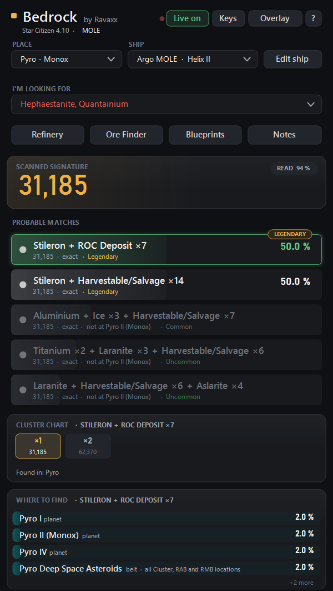
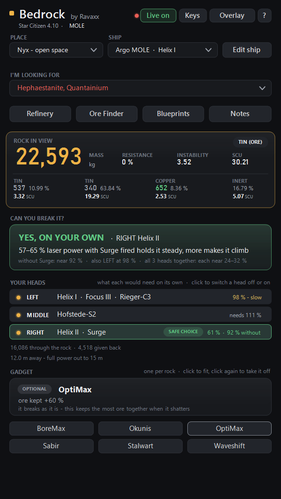
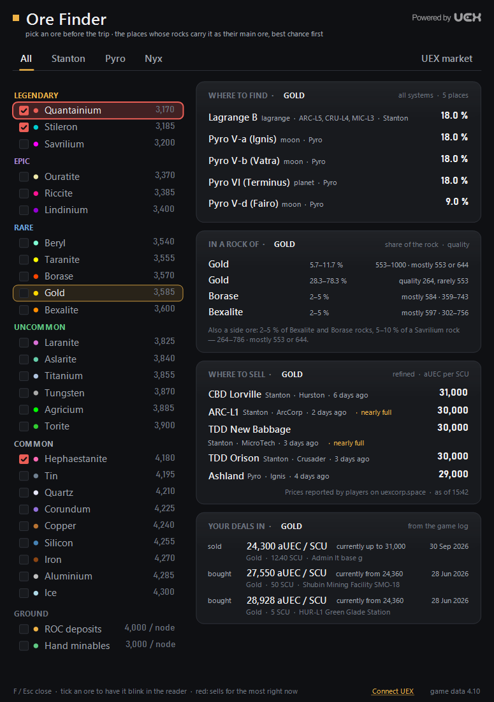
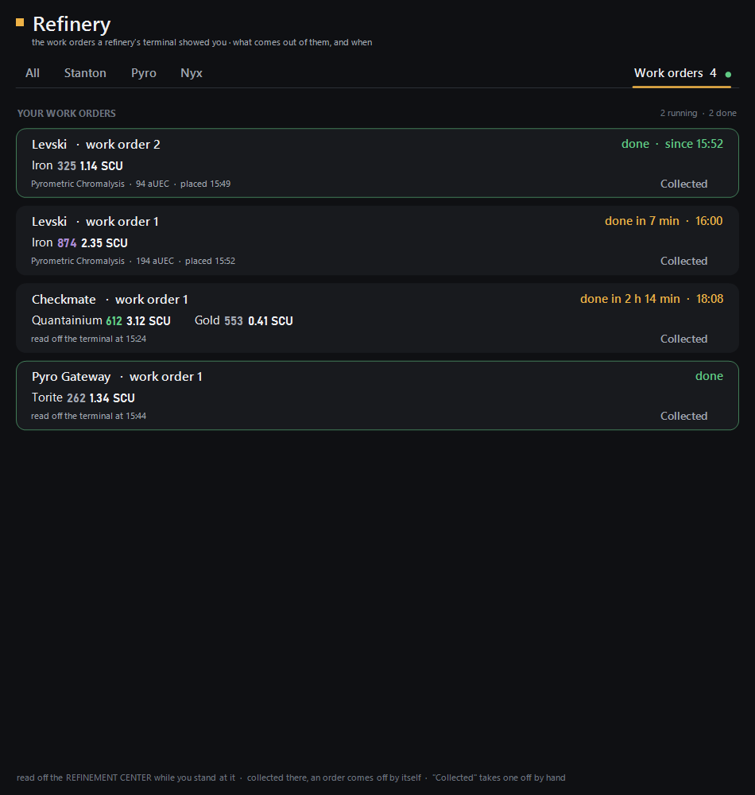

# Bedrock - Mining Companion for Star Citizen

Bedrock reads the mining scanner off your screen and tells you what you are
looking at, and grew from there into the rest of a mining run: what a rock is
made of, whether your laser can break it, where an ore is found and where it
sells best, your refinery work orders, and your blueprints.

It is free, needs no account and no installer, and runs on Windows and on
Linux (AppImage, also SteamOS). Current version: 2.6.6, for Star Citizen 4.10.2.

**Download:** the [Releases](https://github.com/SC-Ravaxx/Bedrock/releases) page - on Windows,
unzip it anywhere and start `Bedrock.exe`; on Linux, make the AppImage
executable and start it. The app tells you when a newer version is out.

| | |
|---|---|
|  |  |
|  |  |

## What it does

- **Signature scan:** reads the number off the scanner marker and says which
  ore and how many rocks are behind it, the most likely match first.
- **Rock view and overlay:** each ore in the rock with its quality and SCU,
  whether your laser can break it, which MOLE head to use and which gadget
  would help. The overlay shows the same over the game.
- **Ore Finder:** where an ore is found, what a rock of it usually holds, and
  where refined ore sells best right now (prices players report on
  [UEX](https://uexcorp.space)), next to your own trades from the game log.
- **Refinery:** reads your work orders off the refinery terminal and shows
  when each one is done.
- **Blueprints:** your blueprint library from the game log, every crafting
  recipe with what quality does to it, and the contracts that hand them out.
  Optionally it marks contracts that pay out blueprints with `[BP]` in the
  game's own contract list.
- **Refinery jobs to UEX (optional):** connect your UEX account and Bedrock
  adds the refinery jobs you start to it. Off unless you agree.

## How it reads the game

Bedrock uses the picture Windows already makes of the desktop (Desktop
Duplication, the same thing screen recorders use; on Linux the X11 window of
the game) and mostly looks at a small area around the crosshair, at most
about three times a second. The reading runs on the CPU at below-normal
priority, so the game gets the CPU first, and it slows down when another
window covers the game. The overlay is a normal window on top of the game.

It also reads `Game.log`, the log the game writes itself, for places, trades,
contracts and blueprints. It does not read the game's memory, attach to its
process or inject anything. The `[BP]` option writes a language file into the
game folder, the way language packs do.

Network: an update check (official builds only), UEX's public price lists
while the Ore Finder is open, and your refinery jobs to UEX only if you switch
that on.

## Building

Bedrock is C++20 and builds with CMake. Everything the build needs is in this
repository; the game tables are already generated.

### Windows

You need Windows 10/11 (x64), Visual Studio 2022 or its Build Tools with
"Desktop development with C++", CMake 3.20 or newer (the one that comes with
Visual Studio is fine), Git, and [vcpkg](https://github.com/microsoft/vcpkg).

```powershell
git clone https://github.com/microsoft/vcpkg $env:USERPROFILE\vcpkg
& $env:USERPROFILE\vcpkg\bootstrap-vcpkg.bat
& $env:USERPROFILE\vcpkg\vcpkg install "opencv4[dnn]:x64-windows" "zstd:x64-windows"

cmake -S . -B build -A x64 -DCMAKE_TOOLCHAIN_FILE="$env:USERPROFILE/vcpkg/scripts/buildsystems/vcpkg.cmake"
cmake --build build --config Release
.\build\Release\Bedrock.exe --selftest | Out-Host   # exit code 0 = all checks passed
```

vcpkg copies the DLLs next to `Bedrock.exe`; the `build\Release` folder runs
as it is. `build.ps1` does the same in one go.

### Linux

You need GCC 11 or newer, CMake 3.20+, pkg-config, Qt 6.2 or newer, OpenCV
4.10 or newer with the dnn module, zstd and the X11 development headers. On
Debian or Ubuntu:

```sh
sudo apt install build-essential cmake ninja-build pkg-config qt6-base-dev \
    libopencv-dev libzstd-dev libx11-dev libxcomposite-dev libxext-dev \
    libxfixes-dev libxcb1-dev
cmake -S . -B build -G Ninja -DCMAKE_BUILD_TYPE=Release
cmake --build build --target bedrock bedrock-read
QT_QPA_PLATFORM=offscreen ./build/bedrock --selftest
./build/bedrock
```

If your distribution's OpenCV is older than 4.10, build a small static one
and point CMake at it:

```sh
OPENCV_PREFIX=$HOME/opencv-static tools/linux/opencv_static.sh $HOME/opencv-work
cmake -S . -B build -G Ninja -DCMAKE_BUILD_TYPE=Release -DOpenCV_DIR=$HOME/opencv-static/lib/cmake/opencv4
```

Bedrock reads the game window through X11, which also covers Star Citizen
under Proton or Wine on a Wayland desktop (the game is an XWayland window).
`tools/make_appimage.sh` packs an AppImage if linuxdeploy and its Qt plugin
are on your PATH.

### Options

- `-DBEDROCK_DEV_TOOLS=ON` adds the developer commands (benches, glyph
  harvesting, the screenshot run) and the `SCMINER_*` debug variables. It
  also links Tesseract (`vcpkg install tesseract:x64-windows` or
  `libtesseract-dev`); add `-DBEDROCK_WITH_TESSERACT=OFF` to leave it out.
- `-DBEDROCK_UPDATE_URL=<https address>` sets where the app looks for a newer
  version. Without it, the build never checks for updates. Official builds set
  it; please don't point a changed build at the official address.
- UEX: a build works without a UEX app token. Prices are still loaded;
  sending refinery jobs to UEX is switched off. If you have your own UEX app token,
  put it alone in a file `uex_token.txt` in the repository root (git ignores
  it) and run cmake again. The token does not go into the program: the build
  writes it, mixed, into `uex_token.dat` beside it, and Bedrock reads it from
  there. Official releases carry Bedrock's own token that way.

### Self-test

`Bedrock.exe --selftest` (Linux: `QT_QPA_PLATFORM=offscreen ./bedrock
--selftest`) checks the signature tables, the readers against the test
pictures in `tests/`, the place and trade parsing and much more. It needs no
game, no network and no token. Exit code 0 and `=== Self-test PASSED ===` at
the end mean everything passed.

## Reproducing a release

Official builds are reproducible: the same commit, built with the same tools,
gives byte for byte the same `Bedrock.exe` and the same Linux `bedrock`
binary. Every release package carries `BUILDINFO.txt` (the commit and the
tools it was built with) and `SHA256SUMS.txt` (the hash of every file in it),
and the ? window shows the commit. Bedrock's UEX app token is not in the
program but in `uex_token.dat` beside it, so the program can be rebuilt
without it.

### Windows

Use the versions `BUILDINFO.txt` names - for 2.6.6: Visual Studio 2022
Build Tools with MSVC 19.44.35222 (toolset v143), Windows SDK 10.0.26100.0,
CMake 3.31, and vcpkg; `vcpkg.json` pins every library to one vcpkg
baseline, which vcpkg installs on its own when cmake runs.

```powershell
git clone https://github.com/SC-Ravaxx/Bedrock
cd Bedrock
git checkout <commit from BUILDINFO.txt>
cmake -S . -B build-release -A x64 -DCMAKE_TOOLCHAIN_FILE="$env:USERPROFILE/vcpkg/scripts/buildsystems/vcpkg.cmake" -DBEDROCK_UPDATE_URL=https://the-forsaken.org/bedrock/bedrock-latest.txt
cmake --build build-release --config Release
Get-FileHash build-release\Release\Bedrock.exe
```

The hash matches the `Bedrock.exe` line of `SHA256SUMS.txt`. The update
address has to be given exactly as above: it is part of the program.

### Linux

The official binary is built in an Ubuntu 22.04 root (GCC 11.4.0, Qt 6.2.4,
OpenCV 4.10.0 built static): `tools/linux/jammy_setup.sh` makes the root,
`tools/linux/opencv_static.sh` builds OpenCV in it, and
`tools/linux/build_package.sh` builds Bedrock there (with
`BEDROCK_UPDATE_URL` set as above) and prints the binary's sha256. Compare it
with `usr/bin/bedrock` inside the AppImage
(`./Bedrock-<version>-x86_64.AppImage --appimage-extract`).

### What is not rebuilt from this repository

The DLLs beside `Bedrock.exe` are vcpkg's builds of the pinned libraries and
Microsoft's C++ runtime; the AppImage carries Qt and other libraries from
Ubuntu 22.04. Their hashes are in `SHA256SUMS.txt`, but they come from those
projects, not from this source.

## Where things live

| | |
|---|---|
| the program | wherever you unzip it; it holds nothing of yours |
| your things | `%LOCALAPPDATA%\Bedrock` (Linux: `~/.local/share/bedrock`) - library, notes, shopping list, settings |

The program folder can be replaced or deleted without losing anything of the
player's. A file called `portable.txt` beside the exe keeps everything next
to the exe instead, for a USB stick. See `include/AppPaths.h`.

## What is in here

| | |
|---|---|
| `src/`, `include/` | the app |
| `src/linux/`, `include/win32/`, `include/*Shim.h` | the Linux port: the Win32 and GDI+ calls the app makes, answered with Qt |
| `include/CraftingData.h`, `GameTextMarks.h`, `MiningHardware.h`, `CommodityData.h`, `MiningLocations.h`, `RefineryData.h`, `RefiningData.h` | generated game tables |
| `gen_*.py`, `p4k_to_tables.py` | the scripts that read the game files into those tables |
| `glyphs/`, `glyphs_mfd/` | digit templates the readers match against |
| `resources/` | icons, fonts, the text-line recognition model, embedded pictures |
| `tests/` | pictures the self-test reads |
| `dist/README.txt` | the README that ships to players |
| `tools/` | release and packaging scripts |

## The signature model (Star Citizen 4.10)

Every rock carries a fixed signature that identifies its ore. The scanner
shows base signature x number of rocks in the cluster, and the value always
matches exactly. The rarity of an ore limits the cluster size.

| Rarity | Max cluster | Ores (base signature) |
|---|---|---|
| Legendary | 2x | Quantainium 3170 · Stileron 3185 · Savrilium 3200 |
| Epic | 3x | Ouratite 3370 · Riccite 3385 · Lindinium 3400 |
| Rare | 4x | Beryl 3540 · Taranite 3555 · Borase 3570 · Gold 3585 · Bexalite 3600 |
| Uncommon | 5x | Laranite 3825 · Aslarite 3840 · Titanium 3855 · Tungsten 3870 · Agricium 3885 · Torite 3900 |
| Common | 6x | Hephaestanite 4180 · Tin 4195 · Quartz 4210 · Corundum 4225 · Copper 4240 · Silicon 4255 · Iron 4270 · Aluminium 4285 · Ice 4300 |

Ground signals are matched as well: ROC deposits (4000 x N), hand minables
(3000 x N) and salvage (2000 x N). A scan of 6,370 is Stileron x 2; 8,600 is
Ice x 2. Every signature stands for one resource type; signatures are never
mixed or summed. Ground fields get large (54,000 and 84,000 have been seen);
above 120,000 nothing matches and the reading is treated as a misread.

## The game's own contract texts

Ticking "Show them in the game's contracts" in the Blueprints window makes
Bedrock write `data\Localization\english\global.ini` beside the game's
`Data.p4k`: the game's own text, taken out of `Data.p4k`, with `[BP]` on the
titles of contracts that pay out blueprints and the blueprints listed under
their descriptions (missing ones blue, owned ones plain). It is rewritten
whenever the library changes, and again after a game patch; the game reads it
at its next start. `user.cfg` gets `g_language = english` if it names no
language. A language file that is not Bedrock's (a translation, a community
pack) is left alone. Unticking the box deletes Bedrock's file and nothing
else. See `include/GameTexts.h`.

## Updating the game data

The generated tables are made from one build of the game by the `gen_*.py`
scripts.

1. Out of that build's `Data.p4k`, with unp4k and unforge: the game's own
   English text and its record database.

       unp4k <channel>\Data.p4k english/global.ini
       unp4k <channel>\Data.p4k *.dcb
       unforge Data/Game2.dcb                (about 25 minutes)

   The text must be the game's own, the one inside `Data.p4k`, never a
   language pack's: packs add text the game does not have.

2. From the repository root, with `<x>` the folder that holds `Data\`, `<ini>`
   its `Data\Localization\english\global.ini` and `<out>` a scratch folder:

       python gen_mining_hardware.py <x> <ini> include\MiningHardware.h
       python gen_blueprints_from_p4k.py <x> <ini> resource_guids.json <out>\bp.json   (about 15 minutes)
       python p4k_to_tables.py <out>\bp.json item_classes.json <out>\tables
       python gen_bands_from_p4k.py <x> <out>\bands.json
       set SIGCOMP_BLUEPRINT_NAMES=<out>\bp.json
       set BP_CONTRACT_KEYS=<out>\bp_contract_keys.json
       set ALL_CONTRACT_KEYS=<out>\all_contract_keys.json
       set REPUTATION_JSON=<out>\reputation.json
       python gen_contracts_from_p4k.py <x> <ini> <out>\contracts.json
       python gen_crafting.py <out>\tables\blueprints_all.json <out>\tables\detail <out>\tables\items <out>\bands.json <out>\contracts.json include\CraftingData.h <out>\reputation.json
       python gen_game_texts.py <ini> <out>\bp_contract_keys.json <out>\all_contract_keys.json <out>\bp.json include\CraftingData.h include\GameTextMarks.h
       python gen_commodities.py <x> <ini> resource_guids.json include\CommodityData.h

   The last two headers belong together: the marks name blueprints by their
   row in `CraftingData.h`. `MiningLocations.h`, `RefineryData.h` and
   `RefiningData.h` come from `gen_locations.py`, `gen_refineries.py` and
   `gen_refining.py`, which read a mining-data export from
   [scmdb.net](https://scmdb.net) (not included) and `regolith_lookups.json`.

3. Before committing, compare with what was there as sets, not lines: the
   contracts are sorted by title, and every pool's index moves with any change
   in front of it.

## Command line

| Flag | Effect |
|---|---|
| `--selftest` | runs the built-in tests and exits (exit code 0 = pass) |
| `--debug` | the app plus a console window with diagnostic output |
| `--console` / `-c` | console mode without the window |
| `--updatecheck` | asks for a newer version once and prints the answer |
| `--snapshot` | saves the current game picture for a bug report (also Ctrl+Alt+S) |

A developer build (`-DBEDROCK_DEV_TOOLS=ON`) adds many more: readers run on
saved pictures (`--ocr`, `--glyph`, `--locate`, `--refinery`), template
harvesting (`--harvest`, `--glyphprune`), benches, and `--screenshot <dir>`,
which renders every window with example data.

## Licence

Bedrock is free software under the GNU General Public License, version 3 or
later: see [LICENSE](LICENSE). Some parts are under their own licences or are
not the author's to license (the fonts, the text-line model, Regolith's
tables, the UEX badge and the game's own data); [NOTICE.txt](NOTICE.txt) lists
them. The libraries Bedrock is built on are listed with their licences in
[THIRD-PARTY-NOTICES.txt](THIRD-PARTY-NOTICES.txt) and
[THIRD-PARTY-NOTICES-LINUX.txt](THIRD-PARTY-NOTICES-LINUX.txt).

## Data sources and thanks

- The game's own files (`Data.p4k`, read with unp4k and unforge) and
  `Game.log`.
- [scmdb.net](https://scmdb.net): mining locations, refinery profiles and
  signature values.
- [Regolith](https://regolith.rocks) (RegolithCo-Common, MIT): refining
  tables.
- [UEX](https://uexcorp.space): commodity prices and the player marketplace.
- [Star Citizen Wiki API](https://api.star-citizen.wiki) and
  [Strata](https://strata.celd.space): blueprint and field-size checks.

## Disclaimer

Bedrock is an unofficial fan tool, not made by, endorsed by or affiliated
with Cloud Imperium Games. Star Citizen®, Roberts Space Industries®,
Squadron 42® and Cloud Imperium® are trademarks of Cloud Imperium Rights LLC
and Cloud Imperium Rights Ltd; the game data and in-game text shown are their
property.
